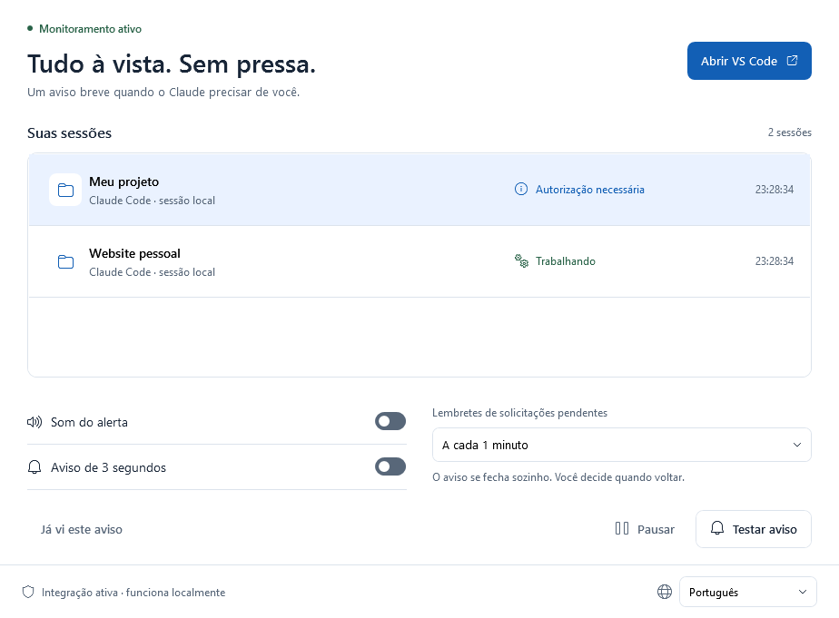
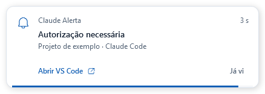
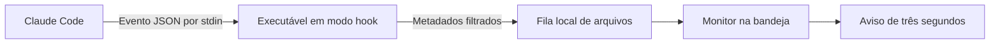

# Claude Alert

**Um aviso breve quando o Claude Code precisar de você.**

O Claude Alert é um aplicativo para **Windows 10/11 x64** que acompanha sessões locais do Claude Code, inclusive as abertas dentro do VS Code. Quando o Claude pede autorização, faz uma pergunta ou termina uma resposta, o aplicativo emite um som opcional e mostra um aviso por **três segundos**. O aviso se recolhe sozinho, sem exigir um clique nem tomar o foco da digitação.

Em português, o nome aparece como **Claude Alerta**. A versão atual é a **1.2.0**, com o tema **Claro** e seleção de idioma: português, inglês, espanhol, alemão, francês e chinês simplificado.



*Interface com dados fictícios. O aplicativo acompanha cada sessão separadamente.*

## O que ele faz

- Avisa sobre autorizações, perguntas, aprovação de planos, respostas concluídas e interrupções por erro.
- Exibe um aviso de três segundos com contagem regressiva e botão para voltar ao VS Code.
- Mantém uma lista das sessões e destaca solicitações que precisam de atenção.
- Permite trocar o idioma de toda a interface sem reiniciar, incluindo avisos, mensagens e menu da bandeja.
- Oferece som opcional, pausa dos alertas e silêncio temporário por cinco minutos.
- Permite lembretes de solicitações pendentes a cada 30, 60 ou 120 segundos, ou desativá-los.
- Continua funcionando na bandeja ao fechar ou minimizar o painel.
- Inicia automaticamente quando chega um evento do Claude e o monitor não está aberto.
- Funciona localmente, sem servidor, conta adicional ou chave de API.



## Requisitos

Para usar uma publicação já compilada:

- Windows 10 ou Windows 11 de 64 bits.
- Claude Code instalado localmente. A integração foi validada com a versão **2.1.312**; ela utiliza hooks com suporte a `command`, `args` e `onFailure`.
- VS Code para usar o botão de retorno ao editor.

Para compilar o código:

- [.NET 10 SDK](https://dotnet.microsoft.com/download/dotnet/10.0) para Windows x64.
- Git para clonar o repositório.
- PowerShell 7 para os scripts auxiliares. Também é possível compilar diretamente com `dotnet publish`.

A publicação padrão inclui o runtime .NET. Quem recebe essa pasta pronta não precisa instalar o SDK nem o runtime separadamente.

## Compilar

```powershell
git clone https://github.com/victorcqueiroz/Claude-Alert.git
cd Claude-Alert
.\scripts\build.ps1
```

O resultado fica em `artifacts/publish/win-x64/`. Abra `ClaudeAlerta.exe` dentro dessa pasta.

Se preferir executar a compilação sem o script:

```powershell
dotnet publish .\ClaudeAlerta.csproj -c Release -r win-x64 --self-contained true -o .\artifacts\publish\win-x64
```

Mantenha os arquivos publicados juntos: o executável depende das bibliotecas que acompanham a pasta. Escolha uma pasta definitiva antes de ativar a integração; os hooks guardam o caminho completo do executável. Se mover a publicação, abra o aplicativo na nova pasta e ative a integração novamente.

## Ativar e usar

1. Abra `ClaudeAlerta.exe`.
2. Clique em **Ativar integração**, caso o botão apareça no rodapé.
3. Abra uma nova conversa do Claude Code no VS Code para carregar os hooks.
4. Clique em **Testar aviso** para conferir a janela e o som.
5. Continue usando o Claude normalmente. O painel pode ficar fechado na bandeja.

Quando não houver sessões, o painel orienta a abrir uma conversa ou enviar uma mensagem ao Claude. As sessões aparecem à medida que os eventos chegam.

| Controle | Comportamento |
| --- | --- |
| **Abrir VS Code** | Restaura uma janela do editor, priorizando um título que contenha o nome do projeto. |
| **Som do alerta** | Liga ou desliga o som. |
| **Aviso de 3 segundos** | Liga ou desliga a janela de aviso. |
| **Lembretes** | Define a repetição de solicitações ainda pendentes. Respostas concluídas recebem um aviso, sem lembretes repetidos. |
| **Pausar / Retomar** | Suspende ou retoma a exibição de novos alertas. |
| **Já vi este aviso** | Reconhece a solicitação selecionada e interrompe seus lembretes. Não responde ao Claude. |
| **Silenciar por 5 minutos** | Suspende temporariamente os avisos. Disponível no menu da bandeja e no menu de contexto do aviso. |

O fechamento automático do aviso **não** aprova a operação, responde à pergunta ou marca a solicitação como vista. Você decide quando voltar ao Claude.

### Desativar

No ícone da bandeja, escolha **Desativar integração** e depois **Sair**. Apenas sair permite que um próximo evento do Claude inicie o monitor novamente.

### Selecionar idioma

No **canto inferior direito do painel**, ao lado do ícone de globo, abra o seletor de idioma. As opções aparecem com seus nomes nativos:

| Idioma | Opção no seletor |
| --- | --- |
| Português | Português |
| Inglês | English |
| Espanhol | Español |
| Alemão | Deutsch |
| Francês | Français |
| Chinês simplificado | 简体中文 |

A alteração é imediata e fica salva para a próxima abertura. Ela atualiza o painel, os estados das sessões, as mensagens, os rótulos acessíveis, o aviso e o menu da bandeja. Os nomes dos seus projetos são preservados. Trocar o idioma não responde às solicitações pendentes nem reinicia a duração de um aviso já aberto.

Português continua sendo o padrão, inclusive para preferências salvas por versões anteriores. A seleção de idioma não altera som, lembretes ou a integração com o Claude. As traduções ficam incorporadas ao aplicativo e não usam serviços de tradução na rede.

## Como funciona

O aplicativo utiliza os [hooks oficiais do Claude Code](https://code.claude.com/docs/en/hooks), em vez de tentar interpretar imagens da tela ou deduzir o estado pelo consumo de CPU.



O mesmo executável tem dois papéis: receber eventos rapidamente no modo hook e manter a interface de monitoramento. O monitor consulta a fila a cada 500 ms.

| Evento | Uso no aplicativo |
| --- | --- |
| `SessionStart` / `SessionEnd` | Acompanha o início e o encerramento das sessões. |
| `UserPromptSubmit` | Indica que o Claude voltou a trabalhar. |
| `PreToolUse` | Identifica perguntas de `AskUserQuestion` e planos de `ExitPlanMode`. |
| `PermissionRequest` | Mostra que uma ferramenta precisa de autorização. |
| `PostToolUse` / `PostToolUseFailure` | Atualiza a sessão após o resultado da ferramenta. |
| `Notification` | Recebe avisos de permissão, ociosidade e solicitações de resposta compatíveis. |
| `Stop` | Informa que o Claude concluiu uma resposta. Isso não comprova que todo o projeto esteja concluído. |
| `StopFailure` | Informa o encerramento de um turno por erro. |

## Configurações e privacidade

A integração acrescenta handlers ao arquivo `~/.claude/settings.json`, preservando as outras configurações e hooks. Antes de alterar esse arquivo, cria uma cópia `settings.json.claude-alerta-*.bak` ao lado dele. A desativação remove somente os handlers do Claude Alert.

Preferências e fila ficam em `%LOCALAPPDATA%/ClaudeAlerta`. Os eventos temporários contêm somente:

- ID da sessão e pasta do projeto;
- nomes do evento e da ferramenta;
- ID da ferramenta, quando disponível;
- tipo de notificação e horário.

Prompts, respostas, comandos, conteúdo de arquivos, mensagens de notificação e transcrições são descartados antes da gravação da fila. O monitor não captura a tela, não aprova ações e não faz requisições de rede. Os testes de interface renderizam apenas a própria janela do aplicativo.

Os arquivos de eventos são apagados após o consumo. Ao iniciar, o monitor descarta eventos com mais de dez minutos. Sessões sem eventos por oito horas saem do painel.

## Limitações

- A configuração vale para sessões **locais** de Claude Code da conta Windows, incluindo sessões no terminal. Não é exclusiva da extensão do VS Code.
- Sessões em WSL, SSH, contêineres ou nuvem precisam de uma ponte adicional, que este projeto não implementa. Codex não é monitorado.
- Hooks de projetos ou políticas podem restringir a configuração do usuário. Se não aparecerem eventos, confira os handlers no menu `/hooks` do Claude e reinicie a conversa.
- Com várias conversas no mesmo projeto, o botão de retorno não seleciona a conversa exata do VS Code.
- Autorizações paralelas da mesma ferramenta podem ter resolução ambígua, pois `PermissionRequest` não fornece `tool_use_id`.
- Uma resposta longa sem eventos não é tratada como uma solicitação de ação.
- Jogos em tela cheia exclusiva podem encobrir o aviso. O aplicativo não usa injeção gráfica para se sobrepor a jogos.
- O executável não possui assinatura digital comercial.

## Testes

Para compilar e executar os testes do monitor:

```powershell
.\scripts\test.ps1
```

Para incluir a verificação da interface, em uma sessão Windows com área de trabalho disponível:

```powershell
.\scripts\test.ps1 -Ui
```

Os testes usam armazenamento isolado em `artifacts/tests/`, sem editar as configurações pessoais do Claude. A verificação de interface pode mostrar janelas brevemente e gera imagens do painel e do aviso para inspeção.

A versão 1.2.0 passou em **35 verificações do monitor e dos catálogos** e **69 verificações da interface**. Elas incluem persistência das preferências, pausa, estado vazio, menu de lembretes, tamanho mínimo da janela, recolhimento de três segundos, troca de idioma sem reiniciar e recuperação do idioma ao reabrir. Consulte [VALIDACAO.md](VALIDACAO.md) para os resultados e os limites dessas verificações.

Um teste de uso real continua sendo útil: em uma nova conversa, solicite uma operação que exija autorização; confira o aviso, responda no Claude e confirme que a pendência desaparece. Depois confira o aviso ao concluir uma resposta simples.

## Estrutura do projeto

```text
ClaudeAlerta.csproj       Projeto C# / .NET 10 para Windows
Program.cs               Inicialização e modo hook
Core.cs                  Fila, estados das sessões e instalação dos hooks
Localization.cs          Seleção, fallback e aplicação das traduções
Locales/                 Catálogos dos seis idiomas incorporados ao aplicativo
Dashboard.xaml/.cs       Painel principal e monitoramento
AlertCard.xaml(.cs)       Aviso com recolhimento automático
ClaroTheme.xaml          Cores e estilos compartilhados
SelfTest.cs              Verificações do monitor e dos hooks
UiCheck.cs               Verificações da interface com dados isolados
scripts/                 Compilação e testes
docs/images/             Imagens demonstrativas
design/                  Registro das propostas visuais
```

Tecnologias: **C#, .NET 10 e WPF**, com `NotifyIcon` do Windows Forms para a bandeja. Não há pacotes de terceiros declarados no projeto. Os ícones usam fontes de sistema do Windows; a fonte não é redistribuída.
