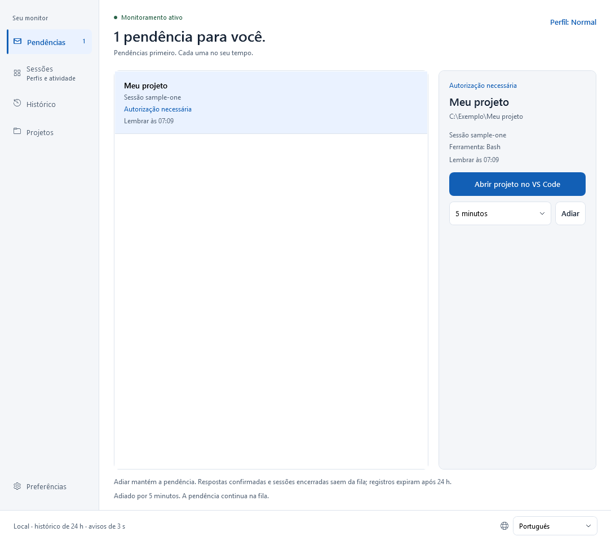
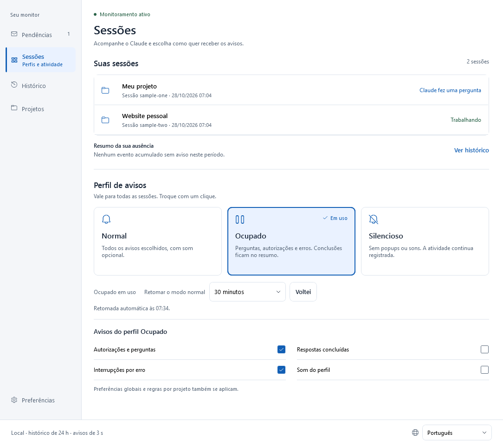
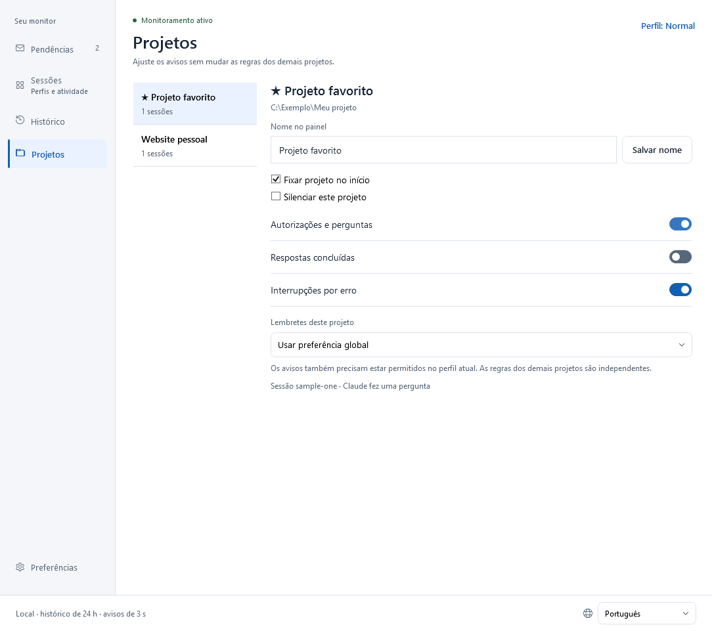
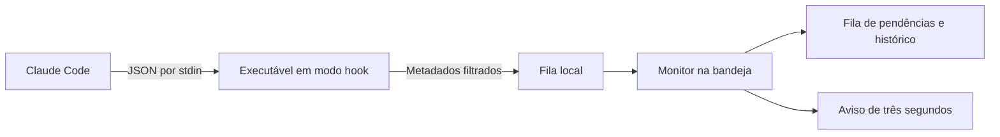

# Claude Alert

**Um aviso breve quando o Claude Code precisar de você. Uma fila para quando você puder voltar.**

Aplicativo local para **Windows 10/11 x64**, feito em C# / .NET 10 e WPF. Acompanha sessões locais do Claude Code, inclusive dentro do VS Code, e avisa sobre perguntas, autorizações, respostas concluídas e erros. O aviso dura **três segundos**, se recolhe automaticamente e não solicita o foco da digitação.

**Versão 1.4.0 · tema Claro · seis idiomas.** Em português, o aplicativo se chama Claude Alerta. Consulte o [histórico de versões](CHANGELOG.md) e a [organização visual aprovada](design/NAVEGACAO.md).


*Capturas da aplicação real com dados fictícios de teste.*

## Baixar e executar

1. Abra a [versão mais recente](https://github.com/victorcqueiroz/Claude-Alert/releases/latest) e baixe `ClaudeAlert-1.4.0-win-x64.zip`.
2. Extraia **todos os arquivos** para uma pasta definitiva e abra `ClaudeAlerta.exe`.
3. Abra **Preferências → Ativar integração**. Se já estiver configurada, a ação aparece como **Atualizar integração**.
4. Abra uma nova conversa do Claude Code no VS Code para carregar a configuração.
5. Use **Preferências → Testar aviso**. Você pode fechar o painel e deixá-lo na bandeja.

O pacote inclui o runtime .NET; não é necessário instalar o SDK para usar. Requer Claude Code local com hooks de comando que aceitem `command`, `args` e `onFailure` (integração originalmente validada com Claude Code 2.1.312). O botão de retorno requer VS Code. O executável não tem assinatura digital comercial.

O arquivo `SHA256SUMS.txt` da publicação permite conferir o ZIP:

```powershell
Get-FileHash .\ClaudeAlert-1.4.0-win-x64.zip -Algorithm SHA256
```

Mantenha os arquivos do pacote juntos. Os hooks guardam o caminho do executável; se mudar de pasta, atualize a integração na nova localização.

## Navegação lateral

O painel abre em **Sessões**. Um único menu à esquerda dá acesso às cinco áreas:

| Área | Conteúdo |
| --- | --- |
| **Pendências** | Fila de solicitações, contexto e adiamento individual. O número no menu indica quantas ainda aguardam ação. |
| **Sessões** | Todas as sessões acompanhadas, resumo da ausência e perfis de avisos. |
| **Histórico** | Respostas confirmadas, respostas concluídas, erros e encerramentos das últimas 24 horas. |
| **Projetos** | Apelidos, fixação, silêncio e regras individuais. |
| **Preferências** | Som, popup, lembretes, teste de aviso e diagnóstico da integração. |

Os controles têm foco visível e semântica nativa para navegação por teclado. Em janelas menores, Sessões e Preferências usam rolagem vertical. Listas extensas de sessões têm altura limitada para manter os perfis acessíveis.

## Pendências: o que ainda precisa de você

Cada solicitação tem sua própria linha, projeto, ID de sessão e ferramenta, quando disponível. Perguntas paralelas na mesma sessão permanecem separadas.



- **Adiar lembrete:** escolha 5, 15 ou 30 minutos para a solicitação selecionada. O aviso também oferece **Adiar 15 min**.
- **Abrir projeto no VS Code:** tenta restaurar a janela correspondente ao projeto ou abrir sua pasta. Não seleciona uma conversa específica.

Fechar o aviso, abrir o editor ou adiar **não responde ao Claude nem resolve a pendência**. Uma confirmação correspondente retira a solicitação da fila. Encerrar a sessão também retira suas pendências, registrando o encerramento. Se houver dúvida na correspondência entre ferramentas paralelas, o aplicativo conserva a pendência para evitar ocultá-la por engano.

As pendências e os adiamentos sobrevivem ao reinício. Estados recuperados exibem **Restaurado · aguardando novo evento**, pois o último estado salvo não comprova que a sessão continua ativa. Os registros têm retenção de 24 horas; o histórico guarda até 500 atividades. Esse prazo também vale para solicitações antigas de uma sessão ainda aberta.

O antigo botão **Já vi** foi substituído pelo adiamento explícito, para que uma solicitação ainda sem resposta não perca seus lembretes indefinidamente.

## Sessões: perfis e atividade

**Suas sessões** aparece primeiro, incluindo sessões trabalhando e aguardando resposta. Logo abaixo ficam os três cartões de **Perfil de avisos**. Clique em qualquer parte do cartão para selecionar; o perfil ativo recebe destaque e a indicação **Em uso**.

As opções em **Avisos do perfil…** ficam sempre abertas e mudam imediatamente com a seleção. Não há menu nem expansor para personalizar autorizações/perguntas, conclusões, erros e som.



| Perfil | Comportamento padrão |
| --- | --- |
| **Normal** | Permite perguntas, autorizações, conclusões e erros. |
| **Ocupado** | Permite perguntas, autorizações e erros; guarda conclusões sem popup e desliga o som do perfil. |
| **Silencioso** | Bloqueia todos os popups e sons; continua recebendo eventos e guardando a atividade. |

Em Normal e Ocupado, você pode escolher as categorias permitidas e o som do perfil. O som também precisa estar ligado nas preferências globais. O modo Silencioso sempre bloqueia avisos, mesmo que um projeto esteja configurado para permiti-los.

Em Ocupado ou Silencioso, escolha retomada **manual**, em **15 minutos**, **30 minutos** ou **1 hora**. O prazo fica salvo e é respeitado após reiniciar o programa. **Voltei** retoma Normal na tela Sessões, onde o resumo indica respostas concluídas e erros que ficaram sem aviso durante sua ausência. As solicitações continuam em Pendências. Alternar entre Ocupado e Silencioso preserva esse período; a retomada automática não abre o painel à força.

Em outras áreas, o atalho **Perfil: …** leva diretamente aos cartões em Sessões. A opção **Ver histórico** abre a atividade detalhada.

No menu da bandeja, **Silenciar por 5 minutos** aplica Silencioso com retorno automático. O painel pode ser aberto com duplo clique no ícone.

### Lembretes com limite

Em **Preferências**, escolha a política global:

- **Progressivo:** primeiro lembrete após 2 minutos; os seguintes após intervalos de 5 e 15 minutos.
- **Intervalo fixo:** 30 segundos, 1 minuto ou 2 minutos, preservando as opções da versão anterior.
- **Sem lembrete:** desliga repetições automáticas.

São **até três lembretes adicionais por solicitação**. Adiar reinicia esse limite e agenda o próximo lembrete para o prazo escolhido. Mesmo com repetições automáticas desativadas, um adiamento explícito agenda um único retorno. Perfil, regras do projeto e preferências de popup/som continuam sendo respeitados. Solicitações diferentes não abrem lembretes simultâneos; o monitor espaça esses lembretes em pelo menos dez segundos.

Respostas concluídas e erros recebem um aviso inicial quando permitido, sem repetições automáticas. A duração de qualquer popup continua sendo três segundos.


## Projetos: regras independentes



Os projetos aparecem quando seus eventos chegam. Você pode:

- dar um apelido que aparece apenas no painel e nos avisos, sem renomear a pasta;
- fixar os projetos mais usados no início;
- silenciar um projeto sem afetar os demais;
- permitir ou bloquear autorizações/perguntas, conclusões e erros;
- herdar o intervalo global de lembretes ou escolher outro para aquele projeto;
- consultar os IDs e os estados conhecidos das sessões.

As regras de projeto **restringem** o perfil atual: um aviso precisa ser permitido em ambos. As pastas são comparadas sem diferenciar maiúsculas, minúsculas ou a barra final. Nomes iguais em pastas diferentes continuam sendo projetos distintos.

## Verificar a integração

Em **Preferências**, **Verificar integração** confere o executável, a presença dos handlers esperados na configuração do usuário e a possibilidade de escrever na fila local. A mesma área mostra separadamente a data do **último evento recebido**.

Uma configuração válida não comprova a entrega de novos eventos. O fluxo completo só é confirmado quando um evento real do Claude chega. Ausência de eventos não é tratada como travamento ou desconexão; uma resposta longa pode não produzir eventos durante algum tempo. Políticas, configurações de projeto e `disableAllHooks` podem afetar a execução dos hooks.

## Idiomas

No canto inferior direito, o seletor discreto oferece **Português, English, Español, Deutsch, Français e 简体中文**. A troca é imediata, inclui toda a navegação, os cartões, as opções dos perfis, os avisos e a bandeja, e fica salva para a próxima abertura. O idioma não altera o estado das pendências nem reinicia o prazo de um aviso aberto.

Português é o padrão. As preferências da versão 1.2.0 preservam idioma, som, popup e intervalo de lembretes. Novas instalações começam com lembretes progressivos. Os catálogos ficam incorporados ao programa e não usam tradução pela rede.

## Dados locais e privacidade

O programa usa os [hooks oficiais do Claude Code](https://code.claude.com/docs/en/hooks). Não tenta interpretar imagens da tela ou inferir atividade pelo consumo de CPU.



O mesmo executável recebe eventos rapidamente no modo hook e mantém o monitor, que consulta a fila a cada 500 ms. Eventos temporários são apagados após serem consumidos e salvos; eventos com mais de dez minutos são descartados. Eventos idênticos recentes são deduplicados, inclusive após reiniciar.

Em `%LOCALAPPDATA%\ClaudeAlerta`:

| Arquivo/pasta | Conteúdo |
| --- | --- |
| `preferences.json` | Idioma, som, popup, perfil, prazo de retorno, apelidos e regras por projeto. |
| `activity.json` | Sessões, solicitações, adiamentos, IDs de ferramentas, histórico e horário do último evento. |
| `inbox/` | Metadados temporários dos eventos. |

São armazenados somente IDs de sessão/ferramenta, pasta do projeto, nomes de evento/ferramenta, tipo de notificação e horários, além dos estados derivados e das preferências escolhidas. **Prompts, respostas, comandos, conteúdo de arquivos, mensagens de notificação e transcrições são descartados antes da gravação.** O aplicativo não captura a tela, não aprova operações e não faz requisições de rede. As capturas de teste renderizam apenas as próprias janelas.

A gravação usa troca atômica de arquivo. Se um arquivo não puder ser restaurado, o painel informa o problema; antes de substituí-lo, conserva uma cópia `*.invalid-*.bak`. Esses backups de recuperação não entram na expiração automática de 24 horas. Se a gravação de atividade falhar, o evento fica na fila para nova tentativa e o painel informa a falha.

A integração altera `~/.claude/settings.json`, preservando outras configurações e hooks e criando uma cópia `settings.json.claude-alerta-*.bak` antes da alteração. Para desativar, escolha **Desativar integração** na bandeja e depois **Sair**. Apenas sair permite que o próximo evento inicie o monitor novamente.

## Limitações

- Monitora sessões **locais** da conta Windows, inclusive no terminal; não é exclusivo da extensão do VS Code.
- WSL, SSH, contêineres e sessões em nuvem precisam de uma ponte adicional, que este projeto não implementa. Codex não é monitorado.
- `Stop` significa fim de uma resposta, não conclusão integral da tarefa. `idle_prompt` é um lembrete de ociosidade, não prova de processamento travado.
- `PermissionRequest` não fornece `tool_use_id`. Quando não é possível correlacionar com segurança uma permissão paralela, ela fica pendente até uma confirmação inequívoca, o encerramento da sessão ou a expiração.
- Eventos perdidos ou fora de ordem podem deixar um estado sem confirmação. Confira a conversa no Claude; o monitor não toma decisões no seu lugar.
- O retorno ao VS Code não identifica a conversa exata. Jogos em tela cheia exclusiva podem encobrir o aviso.
- A limpeza ocorre enquanto o monitor está aberto ou quando inicia novamente; não há um serviço de limpeza com o aplicativo encerrado.

## Compilar, testar e empacotar

Requer [.NET 10 SDK](https://dotnet.microsoft.com/download/dotnet/10.0), Windows x64 e PowerShell 7:

```powershell
git clone https://github.com/victorcqueiroz/Claude-Alert.git
cd Claude-Alert
.\scripts\build.ps1
.\scripts\test.ps1 -SkipBuild -Ui
.\scripts\package.ps1 -SkipBuild
```

A publicação fica em `artifacts/publish/win-x64/`; o ZIP e seu SHA-256 ficam em `artifacts/releases/1.4.0/`. Para usar outro SDK local, informe `-Dotnet C:\caminho\dotnet.exe` aos scripts de compilação, teste ou empacotamento.

Sem o script:

```powershell
dotnet publish .\ClaudeAlerta.csproj -c Release -r win-x64 --self-contained true -o .\artifacts\publish\win-x64
```

Os testes usam armazenamento isolado em `artifacts/tests/`, preservando as configurações pessoais do Claude. `-Ui` exige uma sessão Windows com área de trabalho disponível e pode mostrar janelas brevemente. Os resultados, evidências e limites estão em [VALIDACAO.md](VALIDACAO.md).

## Estrutura

```text
Program.cs               Inicialização, bandeja e entrada dos hooks
Core.cs                  Armazenamento, filtragem e instalação dos hooks
MonitorModel.cs          Solicitações independentes, histórico e persistência
Preferences.cs           Perfis, regras por projeto e política de lembretes
Dashboard.xaml/.cs       Navegação lateral, sessões, perfis e diagnóstico
AlertCard.xaml(.cs)       Aviso com recolhimento em três segundos
ClaroTheme.xaml          Tema Claro e estilos compartilhados
Localization.cs          Aplicação e fallback de idiomas
Locales/                 Seis catálogos incorporados
SelfTest.cs / UiCheck.cs  Testes isolados do monitor e da interface
scripts/                 Compilação, testes e pacote versionado
docs/images/             Capturas de demonstração
```

Não há pacotes de terceiros declarados. Os ícones e as fontes são recursos de sistema do Windows.
