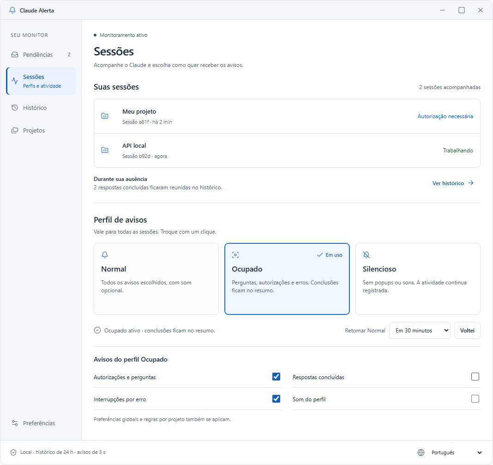

# Navegação aprovada — 1.4.0

O tema Claro permanece: branco, `#125FB5`, superfícies `#F4F6F9` e Segoe UI. O ajuste aprovado reorganiza as funções e substitui os controles de navegação padrão que se afastaram do mockup.

## Referência aprovada

## Janela WPF implementada

Os exemplos usam projetos e sessões fictícios. Ícones seguem a família de glifos do Windows; a barra de título é nativa. Contagem, horários, resumo e estados são preenchidos pelos dados do monitor.

## Organização

- Menu lateral único: Pendências, Sessões, Histórico, Projetos e Preferências.
- Sessões abre como tela inicial. A lista reúne sessões pendentes e em atividade; o resumo da ausência fica logo abaixo.
- Perfil de avisos vem depois de Suas sessões. Normal, Ocupado e Silencioso ficam visíveis como três cartões, sem menu intermediário.
- A indicação Em uso e a borda azul identificam o cartão selecionado sem depender apenas da cor.
- As regras aparecem sempre abertas, com o título Avisos do perfil escolhido. Selecionar outro cartão atualiza imediatamente as opções; Silencioso conserva as regras visíveis e desativadas.
- Retomada e Voltei aparecem quando o perfil não é Normal. As demais áreas oferecem um atalho que leva aos cartões em Sessões.
- Preferências globais e diagnóstico ficam em uma página própria; não competem com a visualização cotidiana das sessões.

## Critérios de implementação

Os elementos são controles WPF nativos com `ControlTemplate` definido em `ClaroTheme.xaml`. A navegação e os perfis usam `RadioButton`, preservando seleção, foco e navegação por teclado. Não se usa `TabControl`, `Expander` ou uma segunda fileira de navegação.

A seleção dos cartões não altera a espessura que participa do layout: o contorno selecionado é sobreposto para evitar deslocamento de conteúdo. Listas e páginas preservam foco visível, rótulos e semântica de acessibilidade.

A janela padrão mede 1100 × 1000 unidades lógicas e se ajusta à área de trabalho disponível. O mínimo é 900 × 700, com rolagem vertical quando necessária. A lista de sessões tem altura limitada, mantendo os perfis ao alcance em cenários com várias sessões.

`UiCheck.cs` verifica a ausência de abas padrão, a ordem vertical, a personalização aberta, a estabilidade dos cartões, troca de perfil, persistência, seis idiomas e alcance dos controles na janela mínima. A aparência também deve ser conferida em capturas da janela real antes de publicar.
